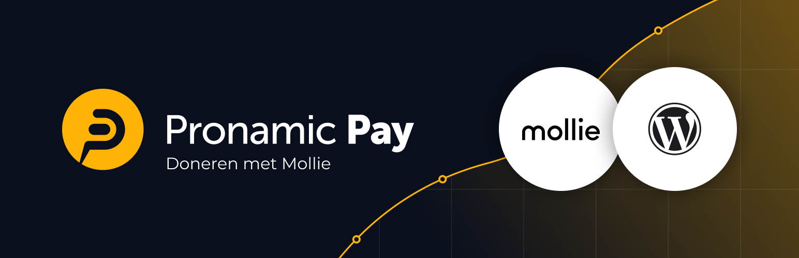
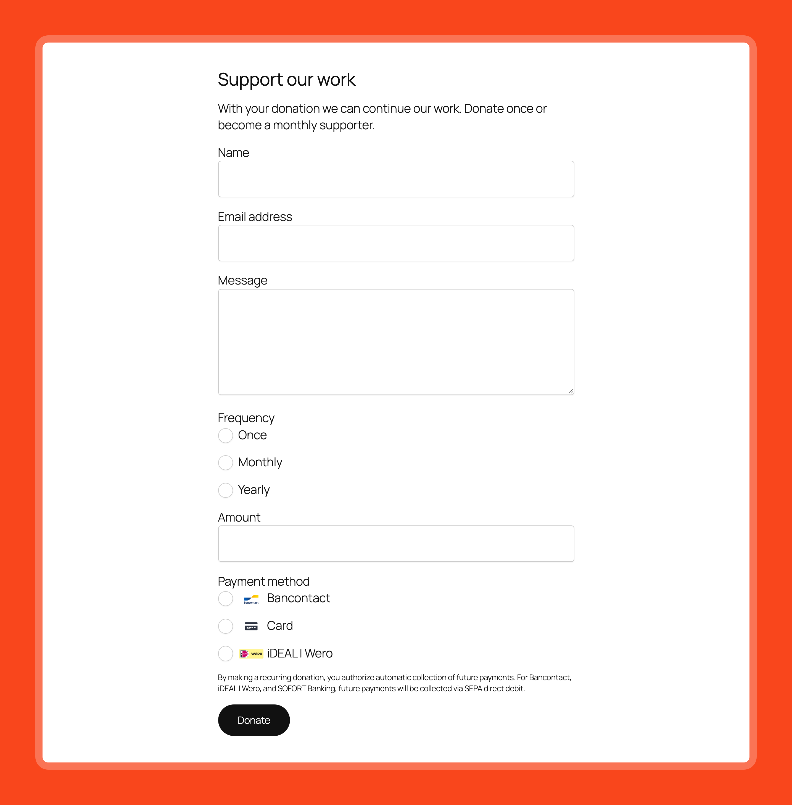
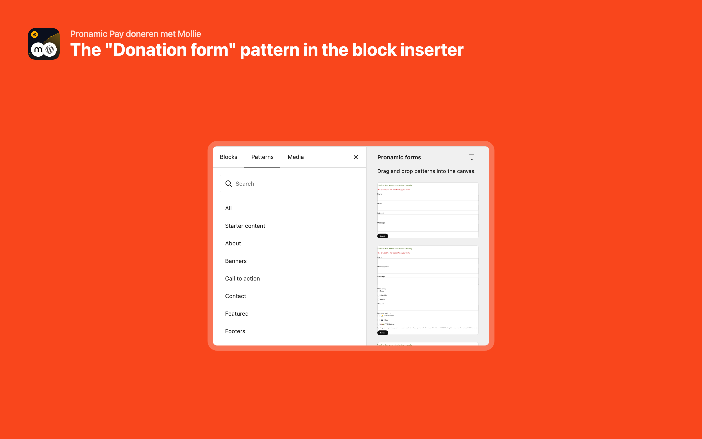
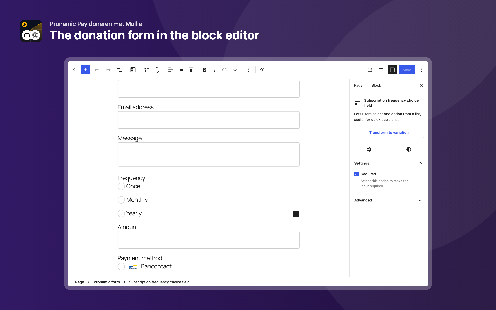
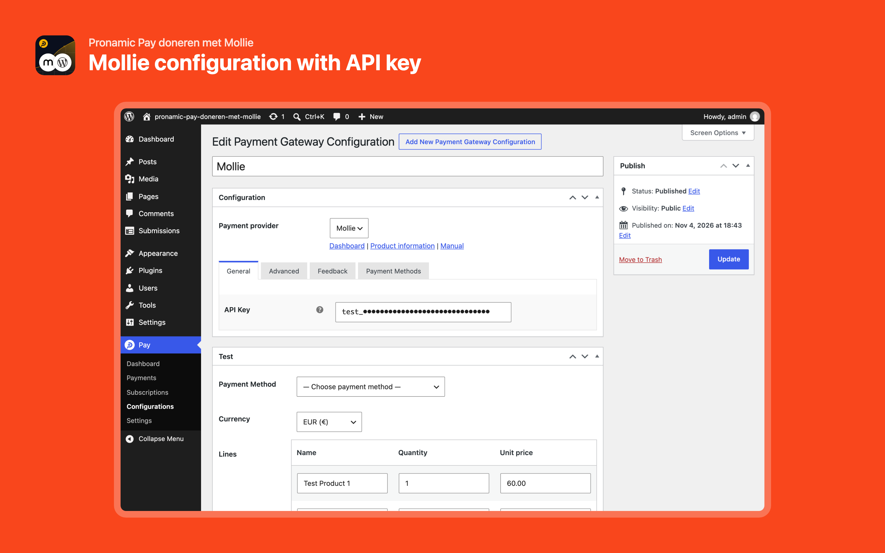
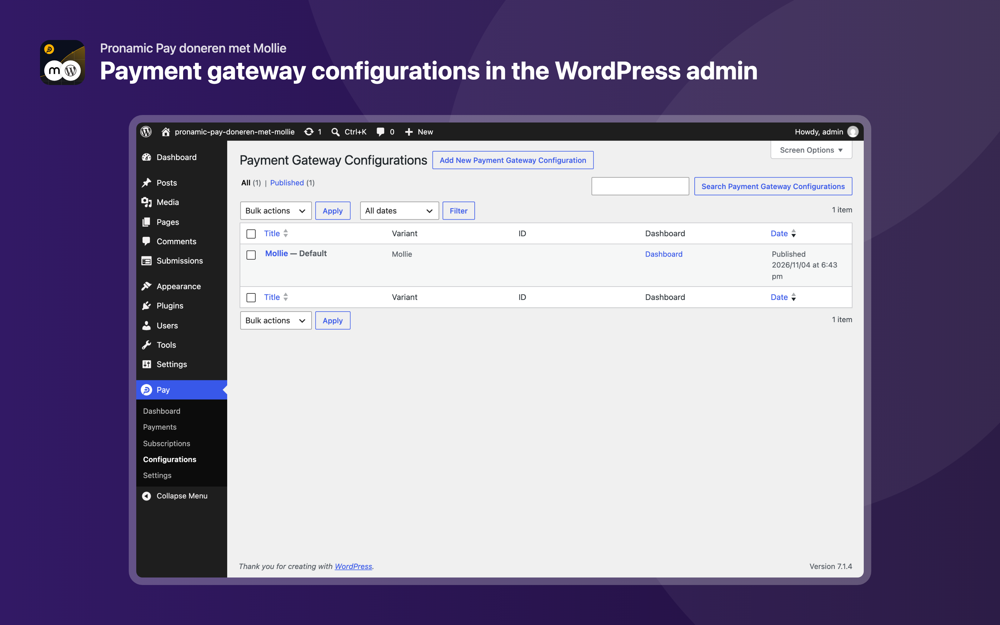

# Pronamic Pay doneren met Mollie

[](https://wordpress.org/plugins/pronamic-pay-doneren-met-mollie/)
[](https://github.com/pronamic/pronamic-pay-doneren-met-mollie/releases/latest)
[](https://www.php.net/)
[](https://wordpress.org/)
[](https://www.gnu.org/licenses/gpl-2.0.html)
[](https://www.mollie.com/)
[](https://playground.wordpress.net/?blueprint-url=https://raw.githubusercontent.com/pronamic/pronamic-pay-doneren-met-mollie/main/.wordpress-org/blueprints/blueprint.json)

**Accept one-time and recurring donations on your WordPress website with Mollie.** Pronamic Pay doneren met Mollie is a free, block-based donation plugin for charities, foundations, associations, churches, schools and other nonprofit organizations. Build your donation form in the block editor, let donors pay with iDEAL | Wero, Bancontact, credit card, PayPal, Apple Pay and many more payment methods, and follow every donation in your WordPress dashboard.

Try the plugin in [WordPress Playground](https://playground.wordpress.net/) with the Live Preview link above. Accepting real payments requires your own [Mollie account](https://www.mollie.com/).



## Why Pronamic Pay doneren met Mollie?

Looking for a modern successor to the “[Doneren met Mollie](https://wordpress.org/plugins/doneren-met-mollie/)” plugin by wobbie.nl / Nick Dijkstra? This plugin is the new way to accept donations with Mollie in WordPress, built on the block editor (Gutenberg) and the [Pronamic Pay](https://www.pronamicpay.com/) payment platform.

- 🧱 **Built with blocks.** A donation form is just a block. Combine it with standard WordPress blocks such as groups, rows, columns, headings and images, so your form matches the design of your website. No shortcodes, no separate form builder and no code.
- 🔁 **One-time and recurring donations.** Let donors choose between a one-time, monthly or yearly donation. Recurring donations are created as subscriptions in Pronamic Pay and collected automatically through Mollie.
- 💳 **All popular payment methods.** iDEAL | Wero, Bancontact, credit card, PayPal, Apple Pay, Google Pay, Klarna, SEPA bank transfer, EPS, Przelewy24, TWINT and more: every payment method that is active in your Mollie account.
- ⚡ **Ready in minutes.** Insert the **Donation form** block pattern, connect your Mollie API key and publish. The pattern includes amount, frequency, payment method, name, email and message fields that you can change or extend.
- ✅ **Reliable payment status.** Payment statuses are updated automatically via Mollie webhooks and the WordPress REST API, and donors return to clear payment status pages.
- 📊 **Everything in your dashboard.** Every donation is stored as a form submission and as a payment in Pronamic Pay, with the donor details, amount, status and a link to the Mollie dashboard.
- 📱 **Responsive and accessible.** Forms use semantic HTML, accessible labels and the WordPress Interactivity API, so they work well on phones, tablets and desktops.
- 🌍 **Multilingual.** Available in English and Dutch (Nederlands), and ready for translation.
- 🆓 **Free and open source.** GPL licensed, developed in the open on GitHub and maintained by [Pronamic](https://www.pronamic.eu/), the team behind Pronamic Pay.

## Table of contents

- [Why Pronamic Pay doneren met Mollie?](#why-pronamic-pay-doneren-met-mollie)
- [Requirements](#requirements)
- [Installation](#installation)
- [Create a donation form](#create-a-donation-form)
- [Recurring donations](#recurring-donations)
- [Payment methods](#payment-methods)
- [Screenshots](#screenshots)
- [In het Nederlands](#in-het-nederlands)
- [External services](#external-services)
- [Development](#development)
- [Links](#links)

## Requirements

- WordPress 6.6 or higher
- PHP 8.3 or higher
- A [Mollie account](https://www.mollie.com/) with at least one active payment method

## Installation

### From WordPress.org

1. In your WordPress admin, go to **Plugins → Add New Plugin**.
2. Search for **Pronamic Pay doneren met Mollie**.
3. Click **Install Now** and then **Activate**.

You can also download the plugin from the [WordPress.org plugin directory](https://wordpress.org/plugins/pronamic-pay-doneren-met-mollie/) or from the [GitHub releases](https://github.com/pronamic/pronamic-pay-doneren-met-mollie/releases) and upload it via **Plugins → Add New Plugin → Upload Plugin**.

### Connect Mollie

1. Go to **Pay → Configurations** and add a new configuration.
2. Choose **Mollie** as the payment provider and enter your Mollie API key. Start with a `test_` key to try everything without real payments.
3. Use the **Test** meta box to start a test payment.

Follow the manual “[How to connect Mollie to WordPress with Pronamic Pay](https://www.pronamicpay.com/en/manuals/how-to-connect-mollie-to-wordpress-with-pronamic-pay/)” for a step-by-step guide.

## Create a donation form

1. Create or edit a page, for example **Donate**.
2. Open the block inserter, go to **Patterns** and insert the **Donation form** pattern, or start from an empty **Pronamic form** block.
3. Adjust the amounts, texts, fields and layout to your needs.
4. Publish the page and make a test donation.

The form is built from these blocks:

| Block | Description |
| --- | --- |
| Pronamic form | The form itself, which starts the payment after submission. |
| Form field | Combines a label and input control into a single, accessible form element. |
| Form label | Adds context to form controls and improves accessibility. |
| Form control | The input element, such as a text, email, number or hidden field. |
| Single-choice field and option | Radio buttons, for example for the amount, frequency or payment method. |
| Multiple-choice field and option | Checkboxes, for example for a newsletter opt-in or consent. |
| Hidden payment amount | Includes a fixed payment amount with the form submission. |
| Form submission notification | Shows a success or failure message after the form is submitted. |

Besides the donation form, the plugin includes patterns for a contact form, an order form and a product configurator form.

## Recurring donations

Recurring donations help your organization with a predictable income. The donation form pattern contains a frequency field with the options **Once**, **Monthly** and **Yearly**. When a donor chooses a monthly or yearly donation, Pronamic Pay creates a subscription for the first payment and Mollie collects the next payments automatically via SEPA Direct Debit or credit card. You can manage subscriptions under **Pay → Subscriptions**.

To accept recurring donations, make sure SEPA Direct Debit and/or credit card are enabled in your Mollie account.

## Payment methods

The plugin supports the payment methods of Mollie, including:

- iDEAL | Wero
- Bancontact
- Credit card (Visa, Mastercard, American Express)
- PayPal
- Apple Pay and Google Pay
- Klarna
- SEPA bank transfer and SEPA Direct Debit
- KBC/CBC and Belfius
- EPS, Przelewy24, BLIK, MB WAY, Multibanco, Satispay, Swish, TWINT, Trustly and more

Which payment methods are available depends on the activated payment methods in your [Mollie dashboard](https://my.mollie.com/).

## Screenshots











## In het Nederlands

**Pronamic Pay doneren met Mollie** is een gratis WordPress-plugin om online donaties te ontvangen met Mollie. Ideaal voor goede doelen, stichtingen, verenigingen, kerken, scholen en andere non-profitorganisaties.

- Maak een **donatieformulier** met de blokeditor van WordPress, zonder code.
- Ontvang **eenmalige en periodieke donaties** (maandelijks of jaarlijks).
- Laat donateurs betalen met **iDEAL | Wero**, Bancontact, creditcard, PayPal, Apple Pay en meer.
- Volg alle donaties en betaalstatussen in je WordPress-dashboard.
- De moderne opvolger van de plugin “Doneren met Mollie”.

Installeer de plugin via **Plugins → Nieuwe plugin**, zoek op “Pronamic Pay doneren met Mollie” en volg de handleiding “[How to connect Mollie to WordPress with Pronamic Pay](https://www.pronamicpay.com/manuals/how-to-connect-mollie-to-wordpress-with-pronamic-pay/)”.

## External services

This plugin connects to the [Mollie API](https://docs.mollie.com/) via `https://api.mollie.com/` to create and process payments. Customer and payment data is passed on to Mollie for this purpose. See the [Mollie user agreement](https://www.mollie.com/user-agreement) for more information.

## Development

```sh
composer install
npm install
npx wp-env start
```

The `.wp-env.json` maps the source to `wp-content/plugins/pronamic-pay-doneren-met-mollie-dev` and the build to `wp-content/plugins/pronamic-pay-doneren-met-mollie`.

### Code quality

```sh
composer run phpcs
composer run phpstan
composer run rector
```

### Build

```sh
composer run build
composer run make-pot
```

### Screenshots

The screenshots in [`.wordpress-org/`](.wordpress-org/) are generated with [Playwright](https://playwright.dev/), see [`scripts/screenshots/`](scripts/screenshots/). They use the build, so run `composer run build` first.

```sh
npx playwright install chromium
composer run build
npx wp-env start
npm run screenshots
```

The screenshots temporarily add a demo page and a Mollie configuration to the `wp-env` site, deactivate the other plugins and remove or restore everything afterwards. The raw screenshots are saved in `build/screenshots/` and then framed on an orange background into `.wordpress-org/`. To adjust only the frame, run `npm run screenshots:frame`; no WordPress needed. If `wp-env` runs on another port, set `WP_BASE_URL`, for example `WP_BASE_URL=http://localhost:8894 npm run screenshots`.

## Links

- [WordPress.org plugin page](https://wordpress.org/plugins/pronamic-pay-doneren-met-mollie/)
- [Pronamic Pay](https://www.pronamicpay.com/)
- [Pronamic](https://www.pronamic.eu/)
- [Mollie](https://www.mollie.com/)
- [Mollie API documentation](https://docs.mollie.com/)
- [Changelog](CHANGELOG.md)

## License

GPL-2.0-or-later
